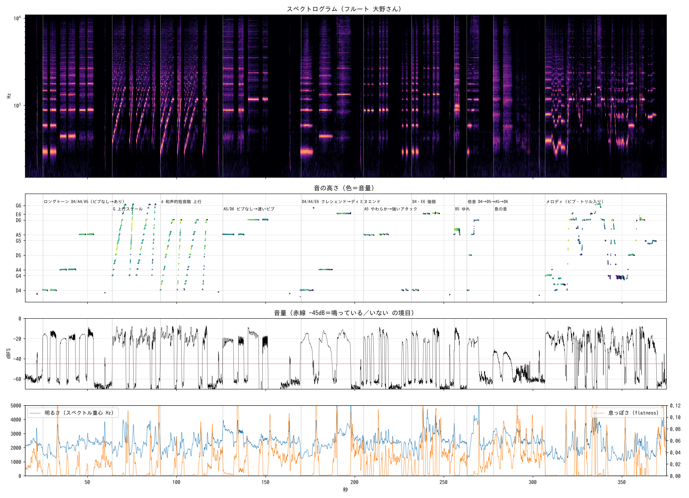

# フルートの 音の 解析（オーディオリアクティブ作品の じゅんび）

フルートの 大野さんから もらった 録音（6分15秒、48kHz / ALAC の m4a）を 解析した 結果。
ヴァイオリンの 作品（iVIOLINE! / Post--Classical-Debussy）と 同じ ような、フルートで うごく オーディオリアクティブ作品を つくる ための 下しらべ。

> 録音そのもの（m4a）は このリポジトリが 公開なので 入れていない。手元の ファイルを `scripts/` に わたして 解析しなおせる。



上から スペクトログラム／音の高さ（色＝音量）／音量（赤線 -45dB＝鳴っている・いない の境目）／明るさ（スペクトル重心）と 息っぽさ（spectral flatness）。

## 録音の 中身（区間）

| 時間 | 内容 |
|---|---|
| 0:25–0:54 | ロングトーン D4 → A4 → A5。それぞれ「ビブラートなし → あり」の 2 本ずつ |
| 1:04–1:28 | G の 上行スケール（G4→G6）の 速いパッセージ ×4 |
| 1:31–1:57 | d 和声的短音階の 上行（D4→D6）×4 |
| 2:06–2:31 | A5・D6 の ロングトーン（ビブラートなし → 速いビブラート） |
| 2:50–3:18 | D4・A4・E6 を クレシェンド → ディミヌエンド |
| 3:25–3:39 | A5 の 短い音：やわらかく ×3 → 強いアタックで ×3 |
| 3:47–4:08 | D4・E6 の 短い音で 強弱 |
| 4:16–4:19 | B5 の 速くて 深い ゆれ（トリル／ビスビリャンドっぽい） |
| 4:23–4:30 | 倍音：息を つがずに D4→D5→A5→D6 と 上がる |
| 4:38–4:48 | 息だけの 音（エアトーン）×2 |
| 5:07–6:09 | メロディ（ビブラート、下りの パッセージ、F#4–G4 の トリル あり） |

奏法の 名前（ビスビリャンド・倍音・エアトーン）は グラフの 形からの 推測。大野さんに たしかめる。
区間の データ: [`data/flute_sections.json`](data/flute_sections.json)。拡大図: [`flute_zoom.png`](flute_zoom.png)

## オーディオリアクティブに する ときの ポイント

1. **音の高さは ヴァイオリンより ずっと とりやすい。**
   フルートは 倍音が ほとんど なく、サイン波に ちかい（flatness の 中央値 0.0004）。
   たとえば D4 は 音の エネルギーの 70% が 基音の 帯域（250–800Hz）に 入る。
   FFT の いちばん 大きい 山が そのまま 音の高さに なる ことが 多く、YIN や 自己相関でも 安定して とれる。
   ただし 倍音の 区間や 高い 音域では ときどき はずれる。
2. **音域は D4–G6（294–1568Hz）の 約 3 オクターブ。**
   4・5・6 オクターブが ほぼ 3 等分（36% / 33% / 31%）なので、オクターブごとに レイヤーを わけるのに むいている。
   よく でる 音は D 33%・A 26%・E 14%（D 調っぽい 素材）。チューニングは A=442Hz くらい。
3. **ビブラートは 音の高さより 音量の ゆれ。**
   ゆれの 速さは ふつう 約 4.2Hz、速いとき 5.5Hz。音の高さの ゆれは ±9 セントくらいで、音量は 5〜9dB ゆれる。
   - ⚠️ ふつうの アタック検出（スペクトルフラックス）だと、ビブラートの 1 周期ごとに「新しい音」と 誤検出する
   - アタックは「無音（-45dB 未満）から 立ち上がった」か「音の高さが 半音以上 かわって 40ms 以上 つづいた」で 判定する のが おすすめ
   - 逆に 音量の 4Hz の ゆれは「ビブラート中」を あらわす パラメータに つかえる
4. **息の 音は べつの チャンネルとして とりだせる。**
   息っぽさ（flatness）は ふつうの 音 約 0.0004 ／ 息だけの 音 0.05–0.09（100 倍以上 ちがう）。
   高音域（5kHz 以上）と 中音域（250–2500Hz）の エネルギー比でも、ふつうの 音 −28〜−36dB ／ 息の 音 −14dB と わかれる。
   「風」や「霧」の 表現に つかえそう。
5. **レベルの めやす**
   - 無音 約 −63dB、演奏中 だいたい −38〜−8dB、いちばん 大きい ところ −0.7dB
   - 鳴っている／いない の 境目は −45dB が よさそう
   - 無音の ときの エネルギーの 88% は 250Hz 以下の 部屋の 低い ノイズ → 200Hz の ハイパスを かけると 安定する
6. **速さ**: 1 音の 長さは 中央値 0.24 秒、速い パッセージでは 0.08〜0.1 秒（1 秒に 10 音くらい）。
   音の高さの なめらか処理を 50ms より 長くすると スケールに ついていけなくなる。

## ファイル

| ファイル | なかみ |
|---|---|
| `flute_overview.png` | 全体図（上の 画像） |
| `flute_zoom.png` | あいまいな 区間（ビブラート・アタック・トリル・倍音・息の音・メロディ）の 拡大 |
| `data/flute_features.csv` | 約 46ms ごとの 数値: `time_s, level_db, pitch_hz, midi, note, brightness_hz, breathiness`（音の高さは 鳴っている ときだけ）。ビジュアルの 試作で 音の かわりに ながしこめる |
| `data/flute_sections.json` | 上の 区間表 |
| `scripts/analyze.py` | 特徴量の 抽出（pyin で 音の高さ、RMS、スペクトル重心、flatness、onset）→ `.npz` |
| `scripts/summary.py` | フレーズごとの まとめ・音域・音名の 割合・チューニング・ビブラート・音の長さ |
| `scripts/detail.py` | フレーズごとの 音の ならびと 音量の かたち |
| `scripts/vib.py` | 音量の ゆれ（ビブラートの 速さ・深さ） |
| `scripts/bands.py` | 帯域ごとの エネルギー比・息の 音の 判定値 |
| `scripts/plot.py` / `scripts/zoom.py` | 全体図・拡大図 |

### 解析しなおす

```sh
pip install numpy scipy librosa matplotlib
ffmpeg -i flute.m4a -ac 1 -ar 22050 flute_22k.wav
ffmpeg -i flute.m4a -ac 1 flute_48k.wav
python3 scripts/analyze.py flute_22k.wav feats.npz
python3 scripts/summary.py feats.npz
python3 scripts/detail.py  feats.npz flute_22k.wav
python3 scripts/vib.py     feats.npz
python3 scripts/bands.py   flute_48k.wav
python3 scripts/plot.py    feats.npz flute_22k.wav flute_overview.png   # 日本語フォント: IPAゴシック
python3 scripts/zoom.py    feats.npz flute_22k.wav flute_zoom.png
```

## つぎに やること

- [ ] ヴァイオリン版（iVIOLINE!）の TouchDesigner ファイルを 見て、同じ パラメータ名・同じ ながれに そろえる
- [ ] 上の しきい値（-45dB ゲート、200Hz ハイパス、flatness で 息を 判定、アタックは 音量の 立ち上がり＋音の高さの 変化）で リアルタイム解析を 試作する
- [ ] 奏法の 名前を 大野さんに たしかめる
